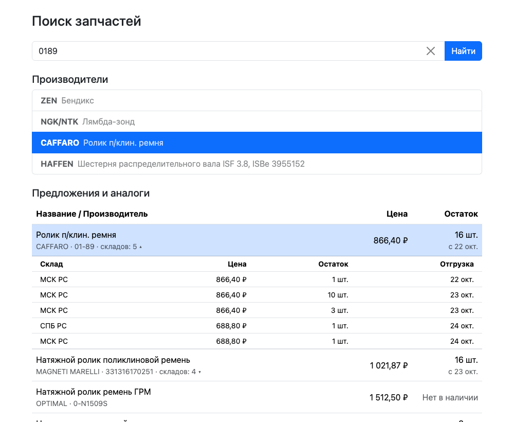

# Поиск запчастей

[](https://github.com/Ellanskii/favorit-parts/actions/workflows/ci.yml)

Тестовое задание: двухэтапный подбор по артикулу через API Favorit-parts.

1. Вводим артикул, получаем список производителей.
2. Выбираем производителя, получаем таблицу с предложениями и аналогами (название, цена, остаток).

Демо: https://favorit-parts.ellanskii.top/



Стек: React, Redux Toolkit, Bootstrap 5, Vite.

## Запуск

```
npm install
npm run dev
npm test
```

В dev запросы к `/api` проксирует Vite, в проде — nginx (см. `nginx.conf`). Прокси нужен, потому что API работает только по http и с https-страницы браузер его блокирует.

Ключ API в браузер не попадает: его добавляет прокси. Берётся из переменной `API_KEY` (для dev — в `.env`, см. `.env.example`), если не задана — тестовый.

## Docker

```
docker build -t parts .
docker run -p 8080:80 -e API_KEY=<ключ> parts
```

`API_KEY` — обычная переменная окружения контейнера, nginx подставляет её при старте. Пересобирать образ для смены ключа не нужно. Healthcheck: `/healthz`.

## Что учтено

- Автопоиск срабатывает через 500 мс после ввода, от 3 символов (чтобы не слать запросы на каждую букву); кнопка «Найти» и Enter отправляют сразу и с любой длиной. Один и тот же номер повторно не запрашивается.
- Если стереть номер короче 3 символов, результаты сбрасываются (кроме номера, который уже запрошен через Enter). Крестик в поле очищает всё.
- Устаревшие ответы игнорируются: в store попадает только ответ на последний запрос.
- Если ничего не найдено, API возвращает одну пустую позицию — она отбрасывается.
- Ошибки API приходят с кодом 200 в поле `error` — обрабатываются так же, как сбои сети, с кнопкой «Повторить». Известные ошибки переведены на русский.
- В таблице сверху выбранный производитель, ниже аналоги по возрастанию цены, позиции без цены в конце.
- Переключатель «Только в наличии» скрывает позиции с нулевым остатком.
- Номер и бренд сохраняются в адресе (`?number=0189&brand=CAFFARO`): ссылкой можно поделиться, после обновления страницы результат на месте.
- Под остатком — ближайшая дата отгрузки. По клику (или Enter) строка раскрывается: склады с ценой, остатком и датой.
